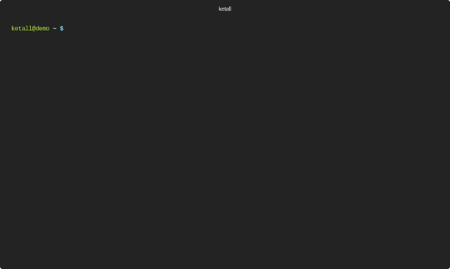

# ketall
[](https://goreportcard.com/report/stackitcloud/kubectl-get-all)
[](https://github.com/stackitcloud/kubectl-get-all/blob/master/LICENSE)
[](https://github.com/stackitcloud/kubectl-get-all/releases)

Kubectl plugin to show **really** all kubernetes resources

This is a fork of [ketall](https://github.com/corneliusweig/ketall)

TODO: add note that this is a fork
TODO: validate readme commands are working

## Intro
For a complete overview of all resources in a kubernetes cluster, `kubectl get all --all-namespaces` is not enough, because it simply does not show everything.
This helper lists **really** all resources the cluster has to offer.

## Demo


## Examples
Get all resources...
- ... excluding events (this is hardly ever useful)
  ```bash
  ketall
  ```

- ... including events
  ```bash
  ketall --exclude=
  ```

- ... created in the last minute
  ```bash
  ketall --since 1m
  ```
  This flag understands typical human-readable durations such as `1m` or `1y1d1h1m1s`.

- ... in the default namespace
  ```bash
  ketall --namespace=default
  ```

- ... at cluster level
  ```bash
  ketall --only-scope=cluster
  ```

- ... using list of cached server resources
  ```bash
  ketall --use-cache
  ```
  Note that this may fail to show **really** everything, if the http cache is stale.

- ... and combine with common `kubectl` options
  ```bash
  KUBECONFIG=otherconfig ketall -o name --context some --namespace kube-system --selector run=skaffold
  ```

Also see [Usage](docs/USAGE.md).

## Installation
There are several ways to install `ketall`. The recommended installation method is via `krew`.

### Via krew
Krew is a `kubectl` plugin manager. If you have not yet installed `krew`, get it at
[https://github.com/kubernetes-sigs/krew](https://github.com/kubernetes-sigs/krew).
Then installation is as simple as
```bash
kubectl krew install get-all
```
The plugin will be available as `kubectl get-all`, see [Usage](docs/USAGE.md) for further details.

### Binaries
When using the binaries for installation, also have a look at [docs/USAGE](docs/USAGE.md).

#### Linux
```bash
curl -Lo ketall.gz https://github.com/stackitcloud/kubectl-get-all/releases/download/v1.3.8/ketall-amd64-linux.tar.gz && \
  gunzip ketall.gz && chmod +x ketall && mv ketall $GOPATH/bin/
```

#### OSX
```bash
curl -Lo ketall.gz https://github.com/stackitcloud/kubectl-get-all/releases/download/v1.3.8/ketall-amd64-darwin.tar.gz && \
  gunzip ketall.gz && chmod +x ketall && mv ketall $GOPATH/bin/
```

#### Windows
[https://github.com/stackitcloud/kubectl-get-all/releases/download/v1.3.8/ketall-amd64-windows.zip](https://github.com/stackitcloud/kubectl-get-all/releases/download/v1.3.8/ketall-amd64-windows.zip)

### From source

#### Build on host

Requirements:
 - go 1.16 or newer
 - GNU make
 - git

Compiling:
```bash
export PLATFORMS=$(go env GOOS)
make all   # binaries will be placed in out/
```
